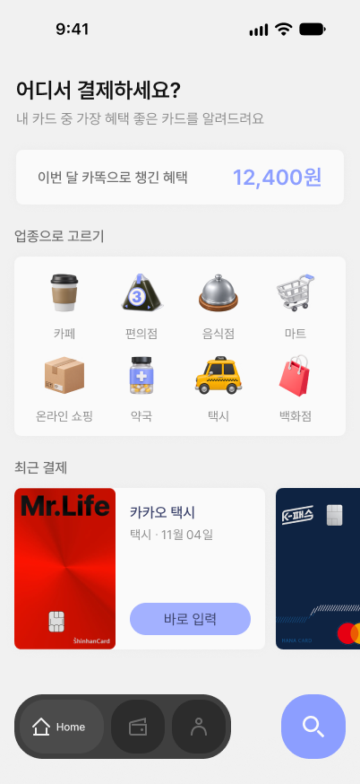
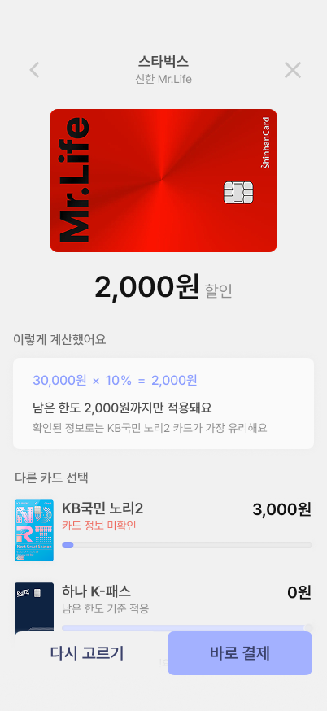
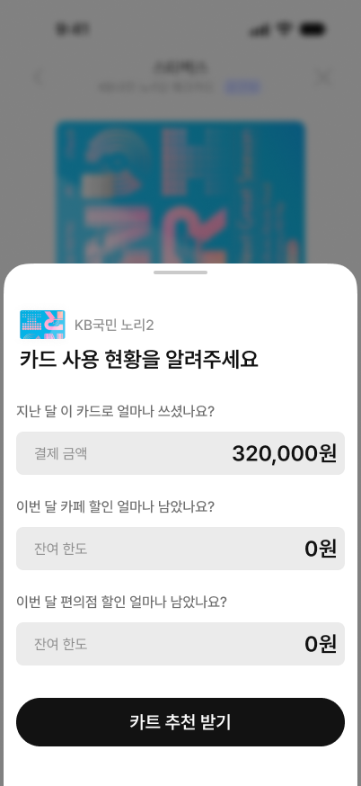
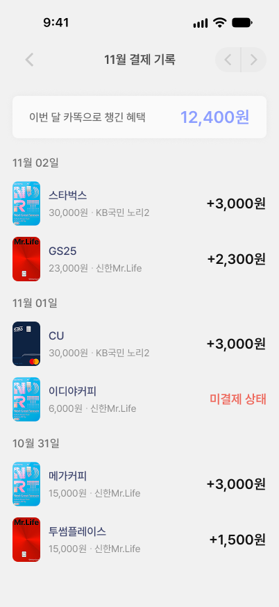
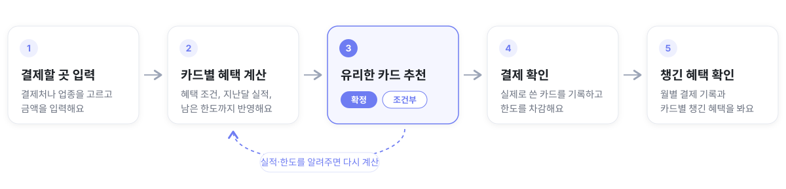
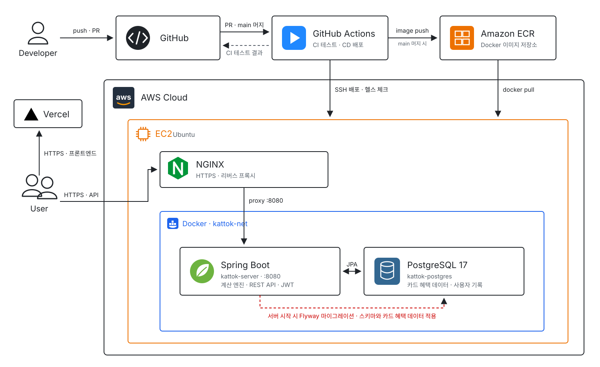
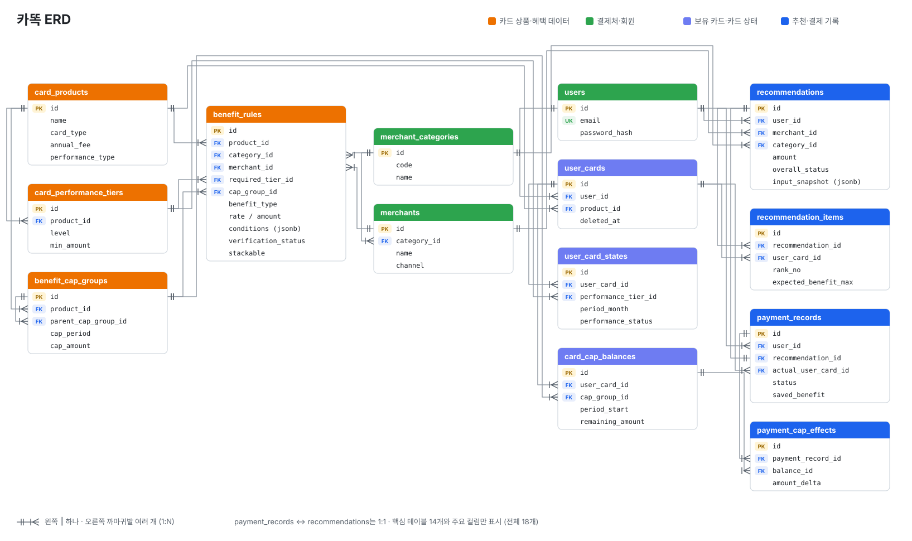

<div align="center">

# 카똑 (Kattok)

### 이번 결제, 어떤 카드로 해야 가장 많이 챙길까?

내 카드의 혜택·실적·한도를 한 번에 계산해 결제할 카드를 골라 주는 서비스


**카똑 · Backend Repository**

</div>

---

## About

카드마다 혜택이 다르고, 같은 카드도 지난달 실적과 이번 달 남은 한도에 따라 받을 수 있는 혜택이 달라집니다. 결제하는 순간에 이걸 다 따져서 카드를 고르기는 어렵습니다.

**카똑은 결제처와 금액만 입력하면, 내가 가진 카드 중 가장 유리한 카드와 예상 혜택을 알려주는 서비스입니다.** 카드사 상품설명서를 기준으로 정리한 혜택 규칙에 지난달 실적과 이번 달 남은 한도를 반영해 계산합니다. 실적이나 한도를 모르면 가정한 내용을 함께 보여주고, 알려주면 다시 계산합니다. 실제로 결제한 카드를 기록하면 한도를 차감하고 이번 달 챙긴 혜택을 모아 보여줍니다.

이 저장소는 회원·인증, 카드와 카드 상태, 혜택 계산 엔진, 추천, 결제 확인과 기록 API, 카드 혜택 데이터를 담당합니다.

## Demo

[카똑 서비스 바로가기](https://kattok.vercel.app/)

## Screenshots

<table>
  <tr>
    <th width="25%">01. 결제할 곳 고르기</th>
    <th width="25%">02. 유리한 카드 추천</th>
    <th width="25%">03. 실적·한도 알려주기</th>
    <th width="25%">04. 챙긴 혜택 확인</th>
  </tr>
  <tr>
    <td></td>
    <td></td>
    <td></td>
    <td></td>
  </tr>
  <tr>
    <td align="center">업종·검색·최근 결제로 결제할 곳을 고르고 금액을 입력해요</td>
    <td align="center">유리한 카드와 계산식, 남은 한도를 비교해요</td>
    <td align="center">모르는 실적·한도를 알려주면 다시 계산해요</td>
    <td align="center">결제를 기록하면 한도를 차감하고 혜택을 모아요</td>
  </tr>
</table>

## Key Features

<table>
  <tr>
    <th nowrap>기능</th>
    <th>설명</th>
  </tr>
  <tr>
    <td nowrap><b>카드 등록</b></td>
    <td>카드사와 상품을 검색해 등록하고, 지난달 실적 구간을 고릅니다. 실적을 모르면 "모르겠어요"로 두고 나중에 입력할 수 있습니다.</td>
  </tr>
  <tr>
    <td nowrap><b>결제 카드 추천</b></td>
    <td>결제처(또는 업종)와 금액을 입력하면 보유 카드를 모두 계산해 비교하고, 1위 카드와 다음 카드와의 차이를 알려줍니다.</td>
  </tr>
  <tr>
    <td nowrap><b>계산 근거 표시</b></td>
    <td>적용한 혜택, 계산식(예: <code>10,000원 × 20% = 2,000원</code>), 결제 후 남은 한도, 가정한 내용을 카드별로 보여줍니다.</td>
  </tr>
  <tr>
    <td nowrap><b>조건부 추천</b></td>
    <td>실적이나 남은 한도를 모르면 가정을 밝힌 조건부 결과를 주고, 사용자가 알려주면 카드 상태를 저장한 뒤 다시 계산합니다.</td>
  </tr>
  <tr>
    <td nowrap><b>결제 확인</b></td>
    <td>실제로 결제한 카드를 기록하면 그만큼 한도를 차감합니다. 다른 카드로 고치면 이전 차감을 되돌리고 다시 계산합니다.</td>
  </tr>
  <tr>
    <td nowrap><b>결제 기록</b></td>
    <td>월별 결제 기록과 카드별로 이번 달 카똑으로 챙긴 혜택을 보여줍니다.</td>
  </tr>
  <tr>
    <td nowrap><b>결제처 검색</b></td>
    <td>별칭으로도 결제처를 찾고(예: "스벅" → 스타벅스), 최근 결제한 곳을 다시 고를 수 있습니다.</td>
  </tr>
</table>

### 추천부터 결제 기록까지



> 카똑의 금액은 카드사 상품설명서 기준의 예상 혜택입니다. 실제 지급액은 카드사 기준에 따라 다를 수 있습니다.

## Tech Stack

| 구분 | 기술 | 사용 목적 |
| --- | --- | --- |
| Language | **Java 21** | 백엔드 애플리케이션 |
| Framework | **Spring Boot 4.1.2 · Spring MVC** | REST API, 요청 검증, 공통 오류 응답 |
| Security | **Spring Security · OAuth2 Resource Server** | JWT(HS256) 발급·검증, 인증이 필요한 API 보호 |
| Persistence | **Spring Data JPA · Hibernate** | 엔티티와 트랜잭션, 카드 상태·추천·결제 기록 저장 |
| Database | **PostgreSQL 17** | 데이터 저장, 혜택 조건·추천 스냅샷은 `jsonb` |
| Migration | **Flyway** | 스키마 변경과 카드 혜택 데이터 적재 |
| API Docs | **springdoc-openapi 3.2.0 · Swagger UI** | API 명세와 요청 테스트 |
| Test & Build | **JUnit 5 · Testcontainers · Gradle 9** | 단위·API·데이터 정합성 테스트와 빌드 |
| CI/CD | **GitHub Actions · Docker · Amazon ECR** | PR 테스트, 이미지 빌드·배포, 배포 후 헬스 체크 |
| Infra | **AWS EC2 · NGINX** | 백엔드 서버와 DB 운영, HTTPS 리버스 프록시 |
| Hosting | **Vercel** | 프론트엔드 배포 |

## System Architecture



추천을 요청하면 서버가 보유 카드의 혜택 규칙과 카드 상태(실적·남은 한도)를 읽어 계산 엔진에 넘기고, 결과를 스냅샷으로 저장한 뒤 돌려줍니다. 결제 확인은 이 스냅샷을 기준으로 한도를 차감하므로, 이후 혜택 데이터가 바뀌어도 과거 기록은 그대로 유지됩니다.

### ERD

테이블을 카드 상품·혜택 데이터, 결제처·회원, 보유 카드·카드 상태, 추천·결제 기록의 네 영역으로 나눴습니다. 아래 그림은 전체 18개 중 핵심 테이블 14개와 주요 컬럼만 보여줍니다. 카드 혜택 규칙은 상품 단위로, 실적과 남은 한도는 보유 카드 단위로 저장하고, 추천 결과와 결제로 인한 한도 차감은 따로 기록해 되돌릴 수 있게 했습니다.

<details>
<summary><b>ERD 펼쳐 보기</b></summary>
<br>

이미지를 누르면 크게 볼 수 있습니다.


</details>

### 추천 계산 방식

1. **적용할 혜택 고르기**: 결제처를 고르면 그 결제처 혜택과 업종 전체 혜택을 함께 봅니다. 업종만 고르면 특정 브랜드 한정 혜택(예: "스타벅스 20%")은 빼고 계산합니다. 금액·요일·시간대·제외 대상 조건도 판정합니다.
2. **지난달 실적 반영**: 확인된 구간이면 그 구간 혜택만, 미달이면 실적 조건이 있는 혜택을 빼고, 모르면 혜택을 받을 수 있는 가장 낮은 구간을 가정합니다.
3. **이번 달 남은 한도 반영**: 월·일·연 한도, 횟수 한도, 여러 혜택이 함께 쓰는 통합 한도를 적용합니다. 남은 한도를 모르면 한도 전액이 남았다고 가정합니다.
4. **카드 안에서 혜택 하나 고르기**: 받을 수 있는 혜택 중 가장 큰 것을 적용하고, 카드사가 중복 적용을 명시한 혜택만 합산합니다.
5. **카드끼리 비교**: 예상 혜택이 큰 순서로 정하고, 같으면 필요한 실적이 낮은 카드 → 연회비가 낮은 카드 → 먼저 등록한 카드 순입니다.

### Technical Highlights

<table>
  <tr>
    <th nowrap>구현 포인트</th>
    <th>설명</th>
  </tr>
  <tr>
    <td nowrap><b>순수 자바 계산 엔진</b></td>
    <td><code>benefit/engine</code>은 스프링·DB에 의존하지 않는 순수 자바 코드입니다. 입력(카드 규칙·카드 상태·결제 정보)과 출력만으로 단위 테스트합니다.</td>
  </tr>
  <tr>
    <td nowrap><b>조건부 추천</b></td>
    <td>모르는 실적·한도를 가정한 내용을 결과에 함께 담고, 그 가정이 순위에 영향을 주는지 표시합니다. 모르는 값을 모두 가장 불리하게 두고 다시 계산한 1위도 함께 구해, 가정 없이 확인된 정보만으로 추천할 카드를 알려줍니다.</td>
  </tr>
  <tr>
    <td nowrap><b>추천 스냅샷</b></td>
    <td>추천 당시의 입력, 카드별 계산식, 적용 혜택, 결제 후 남은 한도를 저장합니다. 결제 확인과 기록은 이 스냅샷을 기준으로 해서, 혜택 데이터를 고쳐도 과거 기록이 바뀌지 않습니다.</td>
  </tr>
  <tr>
    <td nowrap><b>한도 차감·복원</b></td>
    <td>결제 확인마다 실제 차감 내역을 따로 기록합니다. 결제 카드를 고치면 이전 차감만 정확히 되돌리고 다시 차감하며, 같은 답을 다시 보내도 두 번 차감하지 않습니다.</td>
  </tr>
  <tr>
    <td nowrap><b>동시 요청 제어</b></td>
    <td>카드 등록·상태 수정·결제 확인·탈퇴 같은 변경 요청은 사용자 행 잠금으로 순서대로 처리해, 같은 사용자의 요청이 겹쳐도 한도와 기록이 어긋나지 않게 합니다.</td>
  </tr>
  <tr>
    <td nowrap><b>한국 시간 기준</b></td>
    <td>"이번 달", 일·월·연 한도, 요일·시간대 조건을 모두 한국 시간으로 판정합니다. 한도 기간과 챙긴 혜택의 달은 결제 확인 시각이 아니라 추천 시각을 기준으로 합니다.</td>
  </tr>
  <tr>
    <td nowrap><b>검증된 혜택만</b></td>
    <td>카드사 원문과 대조한 규칙만 추천에 씁니다. 결제 수단처럼 판정할 수 없는 조건이 붙은 혜택은 카드 상세에만 보여주고 계산에서는 뺍니다.</td>
  </tr>
  <tr>
    <td nowrap><b>데이터 검사</b></td>
    <td>계산 가능한 카드 121장, 혜택 규칙 576개(2026년 11월 기준)를 배포 전에 자동 검사합니다. 할인율 범위, 다른 카드의 한도 연결, 없는 결제처를 가리키는 조건, 실적 구간 순서 등을 확인합니다.</td>
  </tr>
  <tr>
    <td nowrap><b>정답 케이스</b></td>
    <td>실제 카드 데이터로 "이 결제에는 이 카드가 몇 원"을 손으로 계산한 결과와 엔진 결과를 비교합니다. 데이터 오류를 고칠 때마다 회귀 케이스를 추가합니다.</td>
  </tr>
</table>

## Troubleshooting

### 1. 다른 카드를 골라도 추천 카드로 결제 기록이 남던 문제

- **문제**: 추천 결과에서 2위 카드를 골라 결제하겠다고 해도, 결제 기록에는 1위 추천 카드로 저장됐습니다.
- **원인**: 결제 확인 대기 기록을 만드는 API에 사용자가 고른 카드를 전달할 방법이 없었습니다. 처음에는 추천 결과의 추천 카드 자체를 고른 카드로 바꾸는 방식을 시도했지만, 결제를 저장한 뒤 다시 확정하면 기록의 카드·혜택·한도 차감이 서로 맞지 않게 되는 것을 재현으로 확인했습니다.
- **해결**: 추천 결과(스냅샷)는 추천 당시 그대로 두고, 고른 카드는 결제 확인 대기 기록에만 따로 저장하도록 바꿨습니다(`payment_records.chosen_user_card_id`). 결제 결과를 저장한 뒤에는 이 방법으로 카드를 바꿀 수 없게 막아(409) 기록과 한도 차감이 어긋나지 않게 했습니다.

### 2. 브랜드 한정 혜택이 같은 업종 전체에 계산되던 문제

- **문제**: "스타벅스 20%" 같은 혜택이 메가MGC커피 결제나 업종 '카페'만 고른 결제에도 계산돼 추천 순위가 틀어졌습니다.
- **원인**: 혜택 데이터를 처음 적재할 때는 결제처 데이터가 쿠팡·스타벅스뿐이어서, 브랜드 한정 혜택을 업종 단위로 넣어 둔 상태였습니다.
- **해결**: 혜택 조건에 허용 결제처 목록(`merchantIds`)을 추가해, 업종 혜택이라도 목록에 있는 결제처에서만 적용하고 업종만 고른 결제에는 빼도록 계산 엔진을 고쳤습니다. 브랜드 한정 혜택 55개에 목록을 채우되 규칙 행은 지우거나 늘리지 않아, 한도 연결(FK)과 카드 상세 표시가 그대로 유지되게 했습니다. 결제처 이름이 하나라도 맞지 않으면 마이그레이션이 실패하도록 검사도 넣었습니다.

### 3. 연달아 머지하면 배포가 실패하고, 실패해도 성공으로 보이던 문제

- **문제**: PR 두 개를 연달아 머지하자 배포 두 개가 동시에 실행되어, 같은 이름의 컨테이너를 지우고 만들다 충돌해 배포가 실패했습니다(`container name is already in use`). 또 서버가 시작하다 실패해도 배포 작업은 성공으로 표시됐습니다.
- **원인**: 배포 워크플로에 동시 실행 제한이 없었고, `docker run -d`는 컨테이너만 띄우고 바로 끝나서 서버가 실제로 떴는지 확인하지 않았습니다.
- **해결**: 배포를 한 번에 하나씩 순서대로 실행하도록 `concurrency`를 걸고, 배포 후 `/actuator/health`가 정상 응답할 때까지 최대 3분 기다리도록 했습니다. 응답이 없으면 서버 로그를 남기고 배포를 실패로 표시해, 설정 실수나 마이그레이션 오류를 배포 단계에서 바로 알 수 있게 했습니다.

## Project Structure

```text
kattok-server/
├── docs/                           # 도메인 모델 · 추천 응답 · 코드 규칙 · 개발 가이드
├── src/main/java/com/kattok/server/
│   ├── user/                       # 회원가입 · 로그인 · 내 정보 · 회원 탈퇴
│   ├── card/                       # 카드사 · 카드 상품 · 보유 카드 · 카드 상태(실적·한도) · 한도 차감 장부
│   ├── benefit/
│   │   ├── engine/                 # 혜택 계산 엔진(순수 자바)
│   │   └── service/                # 혜택 규칙 조회 · 계산용 데이터 변환
│   ├── merchant/                   # 결제처 · 업종 · 별칭 검색 · 최근 결제한 곳
│   ├── recommendation/             # 추천 생성 · 조회 · 스냅샷 · 결제 확인 대기 기록
│   ├── payment/                    # 결제 확인 · 결제 기록 · 챙긴 혜택 집계
│   ├── home/                       # 홈 요약
│   ├── global/                     # JWT 보안 · 공통 오류 응답 · 입력 검증 · OpenAPI 설정
│   └── KattokServerApplication.java
├── src/main/resources/
│   ├── db/migration/               # Flyway 스키마 · 카드 혜택 데이터
│   └── application*.yml            # 공통·운영 설정과 로컬 개발 설정
├── src/test/                       # 엔진 단위 · 정답 케이스 · API 통합 · 데이터 정합성 테스트
├── Dockerfile
└── .github/workflows/              # ci.yml(PR 테스트) · deploy.yml(배포 · 헬스 체크)
```

## API Documentation

- [Swagger UI](https://54-116-209-105.sslip.io/swagger-ui/index.html): 전체 API의 요청·응답 형식과 요청 테스트
- [추천 응답 상세](docs/recommendation-response.md) · [코드 규칙](docs/conventions.md)
- [개발·협업 가이드](docs/development.md): 로컬 실행, 환경변수, 테스트, 배포, 브랜치·커밋 규칙

Swagger에서 `POST /api/v1/auth/login`으로 토큰을 받은 뒤, **Authorize**에 입력하면 인증이 필요한 API를 호출할 수 있습니다.

## Getting Started

JDK 21과 Docker가 필요합니다.

```bash
docker compose up -d
```

```bash
./gradlew bootRun
```

```bash
./gradlew test
```

자세한 내용은 [개발·협업 가이드](docs/development.md)를 참고해 주세요.

## Team & Roles

**카똑 · 백엔드 담당**

| 이름 | 역할 | 담당 |
| --- | --- | --- |
| [문효재](https://github.com/hyojae02) | Backend | 혜택 계산 엔진, 카드 추천, 결제 확인·기록, 챙긴 혜택, 회원가입·로그인, 계정·탈퇴, API 명세 |
| [황준호](https://github.com/junhnno) | Backend | 카드 혜택 데이터, 카드 API, 카드 상태(실적·한도), 결제처, 배포·CI/CD |
